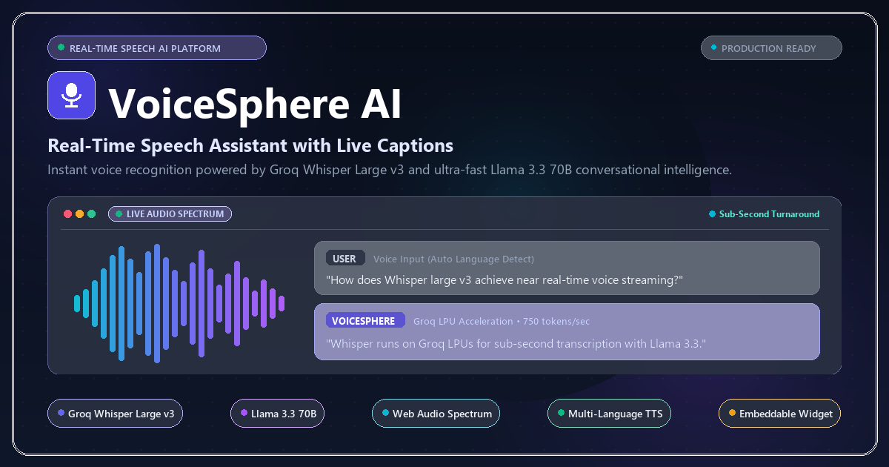
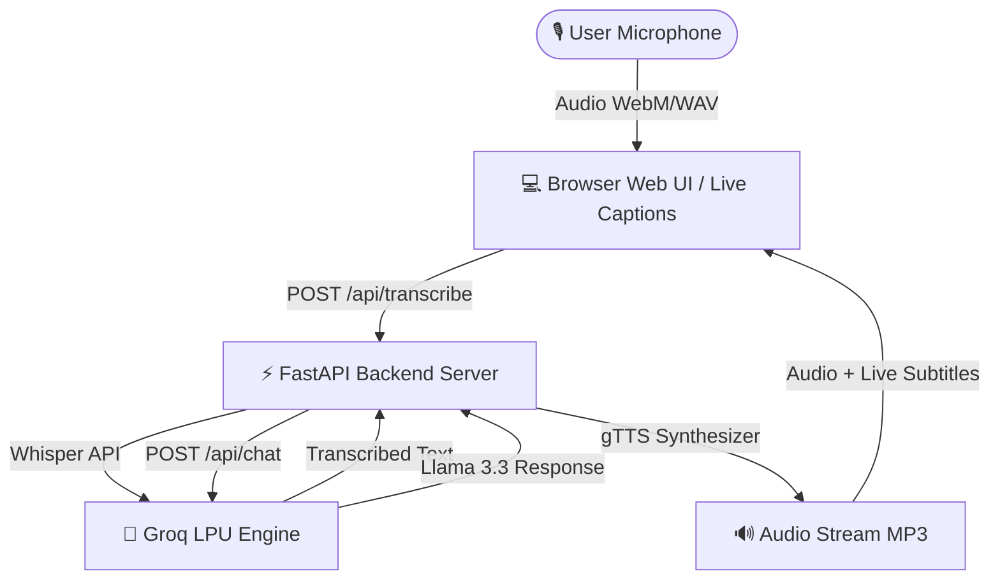

<div align="center">

# 🎙️ VoiceSphere AI
### *Real-Time Speech Assistant with Live Captions, Groq Whisper & Llama 3.3*

[](https://fastapi.tiangolo.com/)
[](https://groq.com/)
[](https://www.python.org/)
[](https://vercel.com/)
[](LICENSE)

<br/>

<p align="center">
  
</p>

<p align="center">
  A high-performance, real-time AI voice assistant featuring ultra-fast speech recognition, live captions, interactive audio waveform visualizer, and streaming text-to-speech response.
</p>

[Features](#-key-features) • [Demo & UI](#-interface--live-captions) • [Quick Start](#-quick-start) • [Deployment](#-deployment) • [API Specs](#-api-endpoints)

---

</div>

## ✨ Key Features

- ⚡ **Ultra-Fast Speech Transcription**: Uses Groq's **Whisper Large v3** model for instantaneous, high-accuracy voice-to-text.
- 🧠 **Smart AI Conversations**: Powered by **Llama 3.3 70B Versatile** on Groq's LPU acceleration engine.
- 🌍 **Zero-Config Multi-Language Auto-Pipeline**: Speak in any language Whisper supports; the system auto-detects it, instructs the LLM to reply in the user's native tongue, and synthesizes Text-to-Speech back using the matching native voice.
- 🧩 **Embeddable Shadow DOM Widget**: A self-contained, floating voice/text assistant widget that can be integrated onto any host site with a single `<script>` tag, completely isolated from host CSS clashes.
- 📝 **Live Captions Banner**: Real-time speech subtitles while you talk, followed by animated typewriter captions when the AI responds.
- 🌊 **Interactive Soundwave Visualizer**: HTML5 Canvas rendering dynamic audio frequency spectrums for microphone input & speech output.
- 🔊 **Seamless Background Audio Playback**: Zero-popup HTML5 Audio streaming & background PyAudio/pygame playback for terminal mode.
- 🚀 **1-Click Cloud Deployment**: Pre-configured for **Vercel**, **Hugging Face Spaces**, **Render**, and **Docker**.

---


## 🏗️ System Architecture



---

## 💻 Interface & Live Captions

The web interface features a dark neon glassmorphism aesthetic:

| Component | Description |
| :--- | :--- |
| **Live Subtitle Card** | Displays real-time speech-to-text captions while you speak |
| **Microphone Core** | Pulsating glowing state indicator (`Idle` / `Listening` / `Transcribing` / `Speaking`) |
| **Frequency Canvas** | Dynamic soundwave visualizer powered by Web Audio API |
| **Conversation Feed** | Full transcript history with user prompts & AI answers |

---

## 🚀 Quick Start

### 1. Prerequisites
- Python **3.10+** installed
- A free **Groq API Key** from [console.groq.com](https://console.groq.com/keys)

### 2. Installation

Clone the repository and install dependencies:
```bash
# Clone the repository
git clone https://github.com/your-username/VoiceSphere-AI.git
cd VoiceSphere-AI

# Install required Python packages
python -m pip install -r requirements.txt
```

### 3. Set Environment Variable

Create a `.env` file in the root directory:
```env
GROQ_API_KEY=YOUR_GROQ_API_KEY_HERE
```

### 4. Run Locally

#### 🌐 Launch Web App (Recommended)
```bash
python -m uvicorn server:app --reload
```
Open **[http://127.0.0.1:8000](http://127.0.0.1:8000)** in your browser and press **Spacebar** or click the microphone to speak!

#### 💻 Launch Terminal Mode
```bash
python main.py
```

---

## 🌐 Cloud Deployment (No Credit Card Required)

### ⚡ Deploy to Vercel (100% Free)
1. Push your repository to GitHub.
2. Go to **[vercel.com/new](https://vercel.com/new)**.
3. Import your repository.
4. Add Environment Variable:
   - `GROQ_API_KEY`: `YOUR_GROQ_API_KEY_HERE`
5. Click **Deploy**!

### 📦 Deploy with Docker
```bash
docker build -t voicesphere-ai .
docker run -p 8000:8000 -e GROQ_API_KEY="YOUR_GROQ_API_KEY_HERE" voicesphere-ai
```

---

## 🔌 API Endpoints

| Method | Endpoint | Description | Payload / Query |
| :--- | :--- | :--- | :--- |
| `POST` | `/api/transcribe` | Transcribes audio, auto-detects language | `multipart/form-data` (audio blob) + optional `language` field to force one |
| `POST` | `/api/chat` | Generates AI text response, in the detected language | `{"message": "Hello", "language": "spanish"}` |
| `POST` | `/api/tts` | Converts text into MP3 audio in the matching voice | `{"text": "Response text", "lang": "es"}` |
| `GET` | `/widget.js` | Embeddable voice widget script | none |

---

## 🌍 Multi-Language Support

Speak in any language Whisper supports. `/api/transcribe` returns the detected
language alongside the text; the frontend feeds that straight into `/api/chat`
(so the AI replies in the same language) and `/api/tts` (so the voice matches).
No language picker needed, it's automatic. To force a specific input language
instead, pass a `language` form field (ISO-639-1 code) to `/api/transcribe`.

## 🧩 Embeddable Widget

Any website can add a floating voice/chat assistant with one script tag:

```html
<script src="https://your-domain.com/widget.js"
        data-agent-name="Ava"
        data-color="#4f46e5"
        data-greeting="Hi! Ask me anything."
        data-position="bottom-right"></script>
```

It runs inside a Shadow DOM, so it's fully style-isolated and won't clash
with the host site's CSS. It talks to the same backend, so language
detection carries through automatically. See `static/widget-demo.html`
for a working example (open `/static/widget-demo.html` once the server
is running).

---

## 🛠️ Tech Stack

- **Backend**: FastAPI, Uvicorn, Requests, Python-Dotenv, gTTS
- **Frontend**: Vanilla JavaScript (ES6+), Web Audio API, HTML5 Canvas, CSS Glassmorphism
- **AI Models**: Groq Whisper Large v3 (STT) + Groq Llama 3.3 70B Versatile (LLM)

---

## 📜 License

Distributed under the MIT License. See `LICENSE` for details.

<div align="center">
  <sub>Built with ❤️ using Groq, FastAPI, and Web Audio API</sub>
</div>
